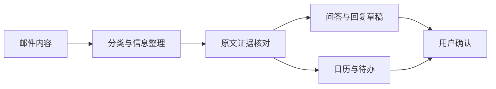

# 校园邮件行动助手

[返回项目索引](https://github.com/18538205298/project-portfolio)

## 项目概览

将邮件阅读与后续行动放在同一工作流中。系统提供分类、原文证据核对、问答、回复草稿、日历与待办，帮助用户从邮件中整理需要处理的事项。

**技术栈**：Vue、Element Plus、FastAPI、SQLModel。

## 功能组成

- **邮件分类**：按内容与处理场景组织邮件。
- **证据核对**：查看原文依据，辅助检查提取的信息。
- **邮件问答**：围绕邮件内容提问。
- **回复草稿**：辅助起草回复，由用户核对内容。
- **行动管理**：将事项整理到行动日历与待办。

## 工作流示意

## 技术要点

- 邮件信息如何与原文证据关联。
- AI 提取结果如何交给用户确认。
- 日历、待办和邮件之间如何关联。
- 邮箱授权、内容存储和日志如何控制访问范围。

## 展示方式

功能演示采用虚构邮件与虚构日程。真实邮件、附件、地址簿、邮箱授权和运行配置留在个人环境中。

## 关键代码

- `samples/extraction.py`：来自原项目 `mail-agent/backend/extraction.py`。
- `samples/checker.py`：来自原项目 `mail-agent/backend/checker.py`。

这些文件保留原项目中的核心逻辑，供阅读和交流。完整应用还包含其余模块、依赖与运行配置。
